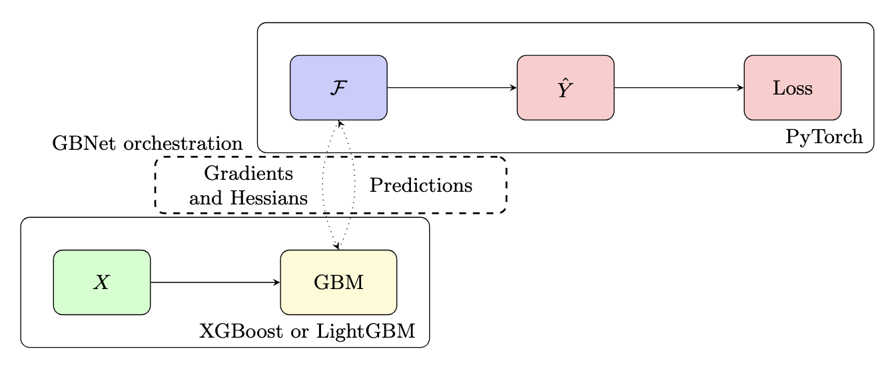

# GBNet
[](https://doi.org/10.21105/joss.08047)
[](https://pepy.tech/projects/gbnet)

PyTorch modules for XGBoost and LightGBM.



---

## What is GBNet?

Gradient boosting (GBM) libraries like XGBoost and LightGBM are excellent for tabular data but can be cumbersome to extend with custom losses or model architectures because you must supply gradients and Hessians by hand.

GBNet wraps GBM libraries in PyTorch Modules so you can:

- Define losses and architectures in plain PyTorch
- Let PyTorch autograd compute gradients / Hessians
- Use XGBoost / LightGBM / boosted linear layers as building blocks inside larger models

At the core of GBNet are three PyTorch Modules:

- `gbnet.xgbmodule.XGBModule` – XGBoost as a PyTorch Module
- `gbnet.lgbmodule.LGBModule` – LightGBM as a PyTorch Module
- `gbnet.gblinear.GBLinear` – a linear PyTorch Module trained with boosting instead of via gradient descent methods

On top of these, GBNet ships higher-level models in `gbnet.models`, including forecasting, ordinal regression and survival models.

---

## Installation

Use a fresh Python environment (Python 3.9 or newer):

```bash
python -m venv .venv
source .venv/bin/activate  # Windows: .venv\Scripts\activate
python -m pip install gbnet
```

The package declares all dependencies needed for both boosting backends and the
built-in models: PyTorch, XGBoost, LightGBM, NumPy, pandas, SciPy, and scikit-learn.
You do not need to install these packages separately or in a particular order.

On macOS, GBNet loads PyTorch before its boosting backends so they can use the
OpenMP runtime bundled with PyTorch. The pip metadata selects PyTorch `<2.11` on
macOS: newer wheels use a different OpenMP library identifier and can segfault
when combined with the boosting libraries. This restriction does not apply to
pip installations on Linux or Windows. Import a GBNet module before importing
LightGBM or XGBoost directly; installing Homebrew's `libomp` alone does not resolve
conflicting runtimes already loaded into a Python process.

Intel Macs need Python 3.9–3.12 because PyTorch no longer publishes newer Intel
Mac wheels. GBNet also selects NumPy `<2` there to match those wheels' binary ABI.
These Intel-specific limits do not apply to Apple Silicon, Linux, or Windows.

### Conda

You can use pip inside a fresh Conda environment:

```bash
conda create -n gbnet python=3.11 pip
conda activate gbnet
python -m pip install gbnet
```

A native Conda recipe is included in `conda/recipe`. It uses conda-forge for all
native dependencies so Conda can select a shared OpenMP runtime. GBNet is not yet
published on conda-forge; a public `conda install -c conda-forge gbnet` requires
publishing the recipe. To build and install it locally from a source checkout:

```bash
conda install --override-channels -c conda-forge conda-build
conda build conda/recipe --override-channels -c conda-forge
conda create -n gbnet-native --use-local --override-channels -c conda-forge python=3.11 gbnet
```

### Check an installation

From a source checkout, run:

```bash
python -m pip check
python -I scripts/smoke_install.py
```

The smoke test uses the installed package, fits both boosting modules and both
forecasting backends, and checks predictions and decreasing training loss in
separate processes with timeouts. It needs no downloaded data or test framework.
The `-I` flag prevents the source checkout from masking a broken installation.
To test unreleased changes locally, use `python -m pip install .` instead of
installing from PyPI. Installation CI tests wheels and source distributions in
fresh environments, and builds and installs the native Conda package.
The PyPI release workflow waits for these installation tests and publishes the
same distribution files they tested.

If a notebook kernel has already loaded conflicting OpenMP libraries, restart
it in a fresh environment and import GBNet first. Avoid mixing pip wheels and
Conda builds of the native dependencies. The upstream
[LightGBM FAQ](https://lightgbm.readthedocs.io/en/stable/FAQ.html#lightgbm-crashes-randomly-with-the-error-like-initializing-libiomp5-dylib-but-found-libomp-dylib-already-initialized)
and [PyTorch issue](https://github.com/pytorch/pytorch/issues/155201) explain these
runtime conflicts. Do not use `KMP_DUPLICATE_LIB_OK` to hide them.

---

## Quick Start: GBMs as PyTorch Modules

**Basic pattern**: treat `XGBModule` or `LGBModule` each as a PyTorch `nn.Module`, build the rest of your model architecture using Pytorch, and call `gb_step()` during training to advance the boosted model. Updating PyTorch components follows its usual `step()` logic.

```python
import numpy as np
import torch
import xgboost as xgb

from gbnet import xgbmodule

# Toy regression data
np.random.seed(0)
n = 1000
input_dim = 20
output_dim = 1
X = np.random.random([n, input_dim])
B = np.random.random([input_dim, output_dim])
Y = X.dot(B) + 0.1 * np.random.randn(n, output_dim)

# XGBModule is a PyTorch Module wrapping XGBoost
model = xgbmodule.XGBModule(
    batch_size=n,
    input_dim=input_dim,
    output_dim=output_dim,
    params={}
)
loss_fn = torch.nn.MSELoss()

X_dmatrix = xgb.DMatrix(X)

losses = []
for _ in range(100):
    model.train()
    model.zero_grad()

    preds = model(X_dmatrix)
    loss = loss_fn(preds, torch.tensor(Y, dtype=torch.float32))
    loss.backward(create_graph=True)  # create_graph=True is required for gbnet
    losses.append(loss.item())

    model.gb_step()

model.eval()
preds = model(X_dmatrix)  # standard PyTorch-style inference
losses                    # decrease to near zero
```

Key ideas:

- Gradients / Hessians are extracted from the PyTorch graph; no need to implement them manually.
- `gb_step()` is the “one more boosting round” operation.
- `XGBModule` and `LGBModule`, as sums of trees, cannot propagate gradients; thus they must sit in the first layer of your architecture.
- Training data must stay fixed while training (no mini-batching). In this way, model training is closer to GBM training rather than Neural Network training.

---

## Built-In Models

GBNet includes higher-level models built on these Modules. These live in `gbnet.models` and follow a scikit-learn-style `fit`/`predict` API.

### Forecasting

`gbnet.models.forecasting.Forecast` provides a time-series model with trend + seasonality + changepoints using GBNet components. It is designed to be competitive with Prophet-style workflows while remaining flexible.

Minimal usage:

```python
import pandas as pd
from gbnet.models import forecasting

# df has columns: 'ds' (datetime), 'y' (target)
df = pd.read_csv("your_timeseries.csv")
df["ds"] = pd.to_datetime(df["ds"])

model = forecasting.Forecast()
model.fit(df, df["y"])

forecast_df = model.predict(df)
print(forecast_df.head())
```

See `examples/simple_forecast_example.ipynb` for a more complete forecasting example.

### Ordinal Regression

`GBOrd` in `gbnet.models.ordinal_regression` implements ordinal regression using GBMs with a PyTorch-defined loss.

- Example notebook: `examples/ordinal_regression_comparison.ipynb`

### Survival Models

GBNet includes survival analysis models under `gbnet.models.survival`, such as:

- `HazardSurvivalModel` – continuous-time hazard model with a gradient-boosted hazard backbone
- `BetaSurvivalModel` – discrete-time survival using Beta distributions with boosting
- `ThetaSurvivalModel` – discrete-time survival via a geometric distribution parameterized by a GBM

Example notebooks:

- `examples/hazard_survival_example.ipynb`
- `examples/discrete_survival_examples.ipynb`

---

## Project Layout and Resources

- `gbnet/` – core library:
  - `xgbmodule.py`, `lgbmodule.py`, `gblinear.py`
  - `models/` – forecasting, ordinal regression, survival, more to come
- `examples/` – Jupyter notebooks:
  - `simple_forecast_example.ipynb`
  - `gblinear_forecast_example.ipynb`
  - `ordinal_regression_comparison.ipynb`
  - `hazard_survival_example.ipynb`
  - `discrete_survival_examples.ipynb`
- `docs/` – docs site

Start with the quick-start code above, then open the notebooks in `examples/` to see end-to-end workflows.

---

## Contributing

Contributions and issues are welcome. Typical ways to help:

- Report bugs or performance issues
- Propose or implement new models built on GBNet modules
- Improve docs, notebooks, or examples

Before opening a pull request:

1. Add or update tests for any new functionality.
2. Run the existing test suite (e.g. `pytest`) if available in your environment.
3. Keep code style consistent with the existing modules.

For larger changes, it’s helpful to open an issue first to discuss design.

---

## Citation

If you use GBNet in academic work, please cite:

```text
Horrell, M., (2025). GBNet: Gradient Boosting packages integrated into PyTorch.
Journal of Open Source Software, 10(111), 8047, https://doi.org/10.21105/joss.08047
```
